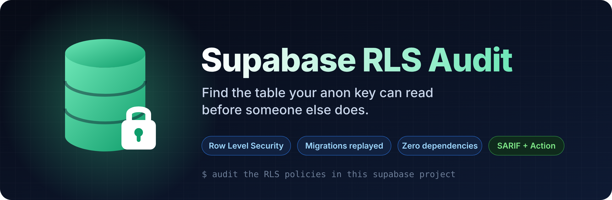

<div align="center">



</div>

# Supabase RLS Audit 🇺🇿

**Anon kalitingiz o'qiy oladigan jadvalni boshqalardan oldin toping.**

Har bir Supabase ilovasida `anon` kalit client ichida turadi va u bilan istalgan jadvalga
to'g'ridan-to'g'ri so'rov yuborish mumkin. Ma'lumotlarni faqat Row Level Security (RLS)
himoya qiladi. Bu skill RLS'ni hujumchi ko'zi bilan tekshiradi, yonidagi analizator esa
migratsiyalaringizni ketma-ket "qayta o'ynab", har bir jadvalning yakuniy holatini topadi.

[English README](README.md)

## Nimalarni topadi

- migratsiyada **RLS yoqilmagan** yoki keyinroq "vaqtincha" o'chirib qo'yilgan jadvallar
- telefon va email bor jadvalda **`using (true)`**
- faqat "tizimga kirganmi" deb tekshiradigan yozish policy'lari (ro'yxatdan o'tish esa hammaga ochiq)
- **`user_metadata`**'ga ishonadigan admin tekshiruvlari: foydalanuvchi uni `auth.updateUser()` bilan o'zi o'zgartira oladi
- barcha policy'larni aylanib o'tadigan **view** va **security definer** funksiyalar
- Flutter ilovasida yoki `NEXT_PUBLIC_` o'zgaruvchisida turgan **service_role kalit**

## Tez boshlash

```bash
npx skills add https://github.com/MBotirjonDev/supabase-rls-audit --skill supabase-rls-audit --global
```

So'ng agentga yozing:

```
audit the RLS policies in this supabase project
```

Faqat analizator (Node 18+, bazaga ulanish shart emas):

```bash
node skills/supabase-rls-audit/scripts/audit.cjs path/to/project
```

Natijada har bir topilma uchun hujumchi yuboradigan so'rov va uni tuzatadigan **yangi migratsiya**
yoziladi.

MIT litsenziyasi. Supabase bilan bog'liq emas.

## Boshqa skill'lar

Shu muallifning boshqa bepul agent skill'lari:

- [Flutter Audit Agent](https://github.com/MBotirjonDev/flutter-audit-agent) — Security audit for Flutter & Dart apps: secrets, storage, TLS, WebViews, Firebase rules
- [Telegram Mini App Audit](https://github.com/MBotirjonDev/telegram-miniapp-audit) — Security audit for Telegram bots and Mini Apps: initData, bot tokens, webhooks, payments
- [Flutter Release Checker](https://github.com/MBotirjonDev/flutter-release-checker) — Finds what gets Flutter apps rejected by Google Play and the App Store
